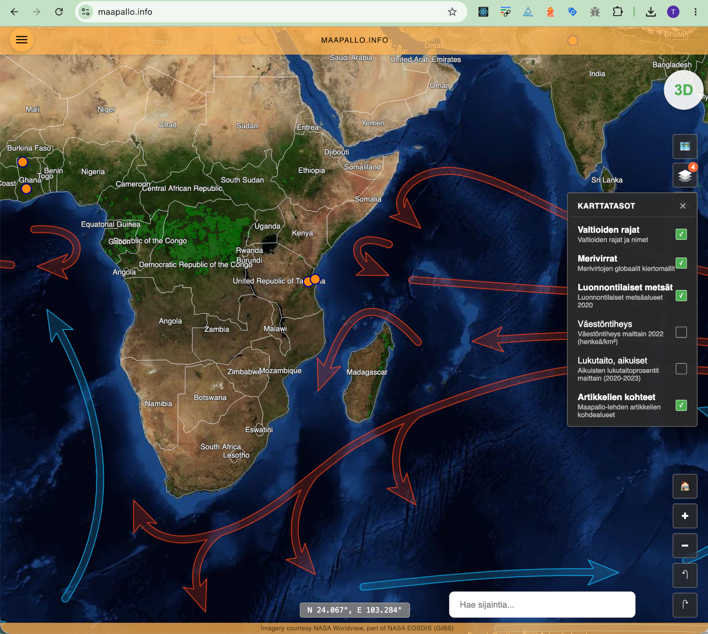

# Maapallo.info

Maapallo.info is a map based portal of global geospatial data related to human development, environment and other geographical phenomena.



The portal is currently in its early development phase. You can access a live preview at https://maapallo.info using the following credentials:

Username: `earth`
Password: `isnotflat`

## Technical Implementation

The map portal runs on [Oskari](https://www.oskari.org/).

- **Oskari**: Java backend on Tomcat and the Oskari frontend (port 8080). The bundle lives in `oskari`, with the Maapallo layout in `custom/WEB-INF/jsp/geoportal.jsp`.
- **Database**: PostgreSQL + PostGIS. Inside Compose it is `db:5432`. On the host it is published at port 5433, because 5432 is the usual local Postgres port. Oskari keeps its configuration in `oskaridb`. GeoServer continues to use `db_dev`.
- **GeoServer**: OGC services for geospatial data (port 8081)
- **PgAdmin**: Database administration interface (port 5050, local setup only)

Map layers, users, and views are managed with Oskari's own admin tools after signing in. The sample content creates an `admin` / `oskari` user on first start.

## Security & Environment Variables

This project uses environment variables for sensitive configuration:

- Copy `.env.example` to `.env` for local development
- Configure GitHub Secrets for production deployment
- Never commit `.env` files to version control

## Local Setup

### 1. Clone repository and navigate to folder

```bash
git clone https://github.com/tonihoo/maapallo-info.git
cd maapallo-info
```

### 2. Build and start application

```bash
# Build all Docker containers
docker compose build

# Start application in background
docker compose up -d

# Check that all containers are running
docker compose ps
```

Oskari creates its database tables on first startup. The first launch can take a couple of minutes.

### 3. Open application

- **Map**: [http://localhost:8080](http://localhost:8080)
- **Oskari admin login**: `admin` / `oskari` (created by the sample application content)
- **GeoServer**: [http://localhost:8081/geoserver](http://localhost:8081/geoserver) (admin/geoserver)
- **PgAdmin**: [http://localhost:5050](http://localhost:5050) (`oskaridb` is the Oskari database, `db_dev` is the GeoServer database)

## Development

### Starting the application

```bash
# Start all containers
docker compose up -d

# Or start individual containers
docker compose up -d oskari
docker compose up -d db
docker compose up -d geoserver
```

### Stopping containers

```bash
# Stop all containers
docker compose down

# Stop individual container
docker compose stop oskari
```

### Following logs

```bash
# Follow all container logs
docker compose logs -f

# Follow logs of one container
docker compose logs -f oskari
docker compose logs -f geoserver
```

## Dependency Management

The running application is the Oskari image in `oskari`. Local Compose watches `oskari/custom/WEB-INF/jsp/geoportal.jsp` and Tomcat recompiles it on the next request, so layout changes do not need an image rebuild. Restart the Oskari container after changing server configuration. Rebuild the image after changing the frontend bundle, the favicon, or the Dockerfile:

```bash
docker compose build oskari
docker compose up -d oskari
```

The frontend source is `oskari/sample-application`. A production build writes `sample-application/dist/2.4.0`, which the Tomcat image copies in. Building that bundle needs the matching `oskari-frontend` checkout; the copy in this repository is already built.

## Container Rebuilding and Reset

### Rebuild containers

```bash
# Rebuild all containers (no cache)
docker compose build --no-cache

# Rebuild individual container
docker compose build --no-cache oskari
```

### Reset all containers and volumes

```bash
# Stop all containers and remove volumes
docker compose down -v

# Remove all containers, networks and build cache
docker compose down --rmi all --volumes --remove-orphans

# Build and start from scratch
docker compose build
docker compose up -d

```

Oskari applies its own database migrations the next time the `oskari` container starts.

### Database reset

```bash
# Stop database and remove data
docker compose stop db
docker compose rm db
docker volume rm $(docker volume ls -q | grep db)

# Start database again
docker compose up -d db

# Wait for the database to be ready, then start Oskari so it can migrate oskaridb
sleep 10
docker compose up -d oskari
```

## Testing

```bash
curl -fsS http://localhost:8080/healthz
curl -fsS -o /dev/null -w "%{http_code}\n" http://localhost:8080/
```

The map page is served by Oskari. GeoServer stays on port 8081.

## Database

Oskari migrates `oskaridb` when the container starts (`db.additional.modules` in `oskari/oskari-server/lib/oskari-ext.properties`). Connection settings inside the container come from `DB_HOST`, `DB_PORT`, `DB_NAME`, `DB_USER`, and `DB_PASSWORD`.

`db_dev` remains the database GeoServer uses for imported geospatial tables.

## Technical Documentation

### Oskari

**Technical stack:**

- **Oskari server**: Java application, `oskari-map.war`, running on Tomcat 10
- **Oskari frontend**: prebuilt bundle in `oskari/sample-application/dist/2.4.0`
- **Layout**: Maapallo header, side menu, basemap switcher, and 2D/3D toggle in `geoportal.jsp`
- **Redis**: started inside the Oskari container for Oskari's cache

The image publishes port 8080 through nginx. Tomcat listens on port 8081 inside the container. Set `BASIC_AUTH_USERNAME` and `BASIC_AUTH_PASSWORD` to require HTTP basic auth in front of the map. Leave them empty for local use.

### PostgreSQL + PostGIS Database

**Configuration:**

- PostgreSQL 13 with PostGIS 3.3
- Spatial data support for geographic features
- Automatic spatial indexing for imported layers

## Troubleshooting

### Common issues

**Container won't start:**
```bash
# Check containers
docker compose ps

# View error logs
docker compose logs <container-name>

# Restart container
docker compose restart <container-name>
```

**Port already in use error:**
```bash
# Check what's using the port
lsof -i :8080  # Oskari
lsof -i :8081  # GeoServer
lsof -i :5433  # database

# Kill process or change port in docker-compose.yml
```

**Database connection error:**
```bash
# Check that database is running
docker compose ps db

# Test connection
docker compose exec db psql -U db_dev_user -d oskaridb -c "SELECT version();"
```

**GeoServer issues:**
```bash
# Check GeoServer status
docker compose ps geoserver

# View GeoServer logs
docker compose logs geoserver

# Test GeoServer web interface
curl http://localhost:8081/geoserver/web/

# Test workspace creation
curl -u admin:geoserver http://localhost:8081/geoserver/rest/workspaces/maapallo
```

**Database contents:**
```bash
docker compose exec db psql -U db_dev_user -d oskaridb -c "\dt"
docker compose exec db psql -U db_dev_user -d db_dev -c "SELECT PostGIS_Version();"
```

**Map doesn't show changes:**
```bash
# Clear the browser cache or use a private window, then restart Oskari
docker compose restart oskari
```

## Azure Deployment

### Production URL ✅

- **Map**: https://maapallo.info/

The site is the Oskari container app `maapallo-client`. GeoServer remains a separate container app. The deployment workflow builds `maapallo-oskari` and rolls that image onto `maapallo-client`, and it creates the `oskaridb` database on the existing PostgreSQL server.

For detailed deployment instructions, see [AZURE_DEPLOYMENT_SETUP.md](./AZURE_DEPLOYMENT_SETUP.md).

### Viewing Azure Logs

```bash
# Stream live logs from Azure
az webapp log tail --name maapallo-info-app --resource-group maapallo-info-group

# Check container logs specifically
az webapp log tail --name maapallo-info-app --resource-group maapallo-info-group --provider application

# Check deployment logs
az webapp log deployment show --name maapallo-info-app --resource-group maapallo-info-group

# Check app status
az webapp show --name maapallo-info-app --resource-group maapallo-info-group --query state

# Restart the app
az webapp restart --name maapallo-info-app --resource-group maapallo-info-group
```
